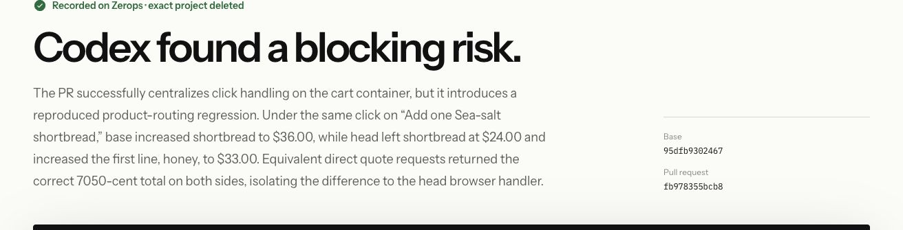
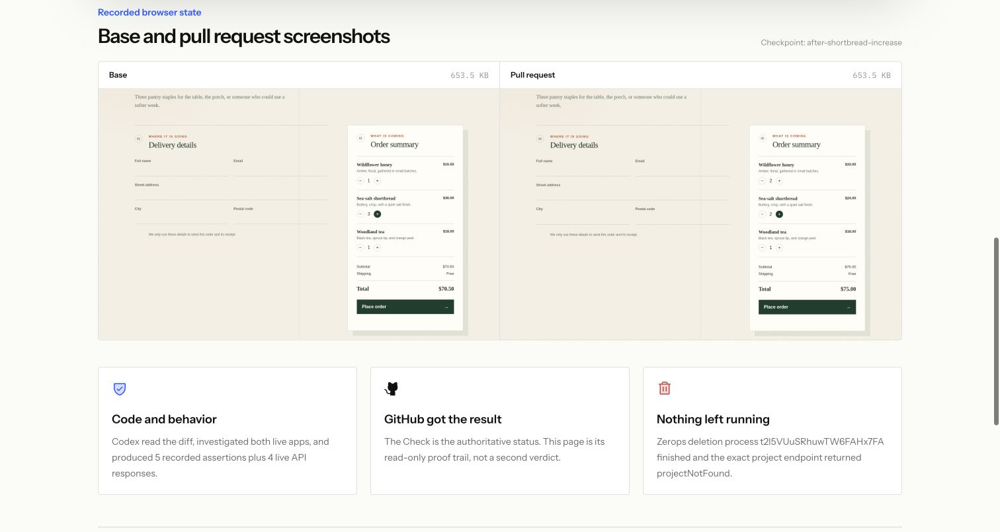
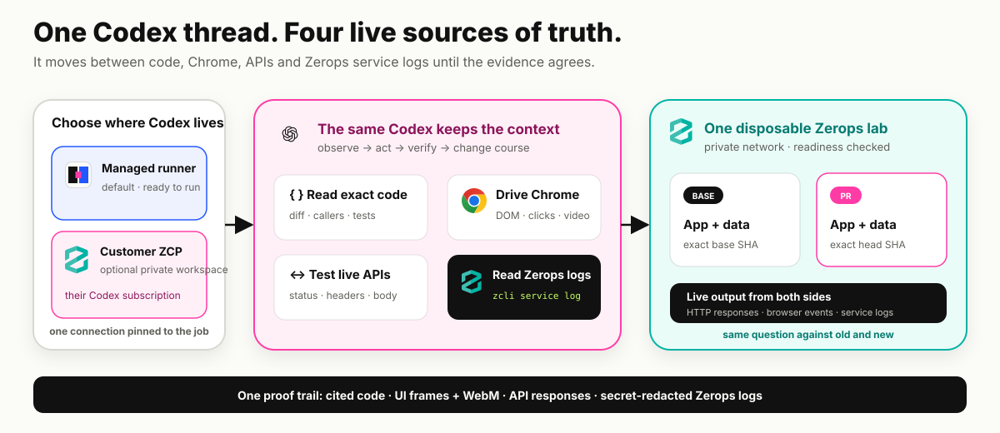
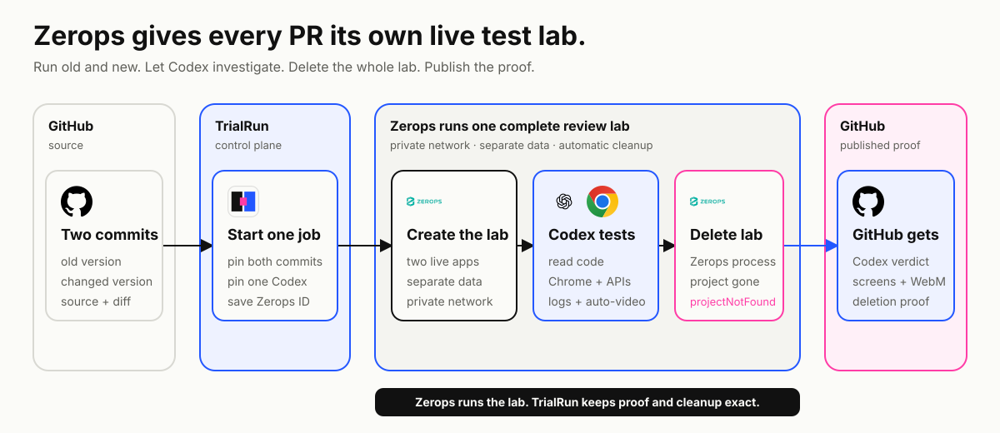

<p align="center">
  
</p>

<h1 align="center">Codex runs the current app and the proposed change in a private Zerops lab.</h1>

<p align="center">
  Connect GitHub. Codex maps the repository and decides what must run. TrialRun turns that into a checked Zerops setup. Zerops starts the current app and the proposed change with separate data. Codex investigates both through code, Chrome, HTTP, and logs; GitHub gets the recorded proof after the lab is deleted.
</p>

<p align="center">
  <a href="https://trialrun.aryankumar.dev"><strong>Open TrialRun</strong></a> ·
  <a href="https://github.com/apps/trialrun-by-aryan">Install the GitHub App</a> ·
  <a href="https://github.com/aryan877/trialrun-proof/pull/4">See the proof PR</a>
</p>

<!-- TRIALRUN_FINAL_PROOF_START -->

### A real PR. A real regression. Reproduced live.

On [proof PR #4](https://github.com/aryan877/trialrun-proof/pull/4), Codex read the cart change, ran the existing app beside the pull request version, and clicked the same second product in each one. The existing app changed item two. The pull request changed item one. Live API calls still returned the right total, so Codex isolated the bug to the pull request's browser handler and cited the exact lines.

[](https://trialrun.aryankumar.dev/proof/reviews/426b3539-3d48-46de-bd6d-8bb78a24c2ca/p1_SHdqvYNZ60xdFOzF9-qT2hTiPTXlbtzQW2T6E0yrfoE)

This one review used 13 repository reads and searches, 17 live browser operations, 4 live API responses, and both applications' Zerops logs. Codex wrote the finding; TrialRun kept the evidence tied to the exact commits.

[](https://trialrun.aryankumar.dev/proof/reviews/426b3539-3d48-46de-bd6d-8bb78a24c2ca/p1_SHdqvYNZ60xdFOzF9-qT2hTiPTXlbtzQW2T6E0yrfoE)

These WebMs are not demo clips or manual uploads. TrialRun's Chrome executor recorded them automatically inside the temporary Zerops project while Codex drove both live apps. The same run captured API responses and Zerops service logs before the project was deleted.

[Watch the base WebM](https://trialrun.aryankumar.dev/proof/reviews/426b3539-3d48-46de-bd6d-8bb78a24c2ca/p1_SHdqvYNZ60xdFOzF9-qT2hTiPTXlbtzQW2T6E0yrfoE/artifacts/a8594caa-7cd0-4cc8-9ecf-c99af4936c3b) · [Watch the pull request WebM](https://trialrun.aryankumar.dev/proof/reviews/426b3539-3d48-46de-bd6d-8bb78a24c2ca/p1_SHdqvYNZ60xdFOzF9-qT2hTiPTXlbtzQW2T6E0yrfoE/artifacts/e3541c1b-653a-4724-b667-fb913bb3675a)

[GitHub Check](https://github.com/aryan877/trialrun-proof/runs/93265050893) · [Bot comment](https://github.com/aryan877/trialrun-proof/pull/4#issuecomment-5232414375) · [Open the public proof](https://trialrun.aryankumar.dev/proof/reviews/426b3539-3d48-46de-bd6d-8bb78a24c2ca/p1_SHdqvYNZ60xdFOzF9-qT2hTiPTXlbtzQW2T6E0yrfoE)

Zerops then deleted project `bm8bQgyTQrC23Kqm5spgnA` in process `t2l5VUuSRhuwTW6FAHx7FA`. TrialRun waited until the exact project lookup returned `projectNotFound`, then published the result.

<!-- TRIALRUN_FINAL_PROOF_END -->

## It reads the code. Then it tests the product.

1. **Codex understands the change.** It searches the full repository, follows the code, and decides what needs to run and what could break.
2. **Zerops boots both versions.** The app running today and the pull request's proposed version get separate services and separate data.
3. **Codex tests its own theory.** It drives Chrome, calls the app's APIs, reads logs, and changes course when the app surprises it.
4. **GitHub gets the proof.** TrialRun saves the evidence, deletes the exact Zerops project, and only then publishes Codex's review.

Chrome is one testing tool, not the boundary. Codex can compare live HTTP status, headers, and response bodies, inspect both applications' Zerops logs, return to the code, and keep investigating in the same thread. In the proof above, the UI diverged while the API responses matched. That distinction is how Codex narrowed the regression to client-side code.



TrialRun gives Codex a short, read-only log tail from the exact current and pull-request services. Test secrets are removed first. That lets Codex connect a browser symptom to an API response, a service error, and the responsible code without receiving Zerops credentials or shell access.

## TrialRun creates the Zerops setup for every repository


The developer never writes `zerops.yaml`.

1. **Codex maps the repository.** It searches the exact commit, follows entrypoints and data clients, and identifies the apps, background workers, data services, build commands, start commands, ports, health checks, environment links, and useful tests.
2. **TrialRun checks the answer.** Normal TypeScript rejects unsupported services, arbitrary public ports, missing readiness checks, production credentials, and plans that exceed the CPU, RAM, disk, or service limits.
3. **TrialRun generates the Zerops setup.** It creates the project import and each service's deployment file. Those files tell Zerops what to build, how the services connect privately, when they are ready, and how many resources they may use. Codex never receives the Zerops account credential.
4. **Zerops runs the real system.** It builds the current app and the version proposed by the pull request, gives each one separate data, and starts the Chrome and API executor beside them on the same private network.

### What it can generate today

| Repository needs       | TrialRun can choose automatically                                                                   |
| ---------------------- | --------------------------------------------------------------------------------------------------- |
| Application runtimes   | Node.js, Python, Go, PHP, .NET, Java, Rust, Ruby, Bun, Deno, Elixir, Gleam, static sites, and Nginx |
| Databases and caches   | PostgreSQL, MariaDB/MySQL, and Valkey/Redis-compatible cache                                        |
| Search and vector data | Elasticsearch, Meilisearch, Typesense, Qdrant, and ClickHouse                                       |
| Messaging              | NATS and Kafka                                                                                      |
| Files                  | Private object storage and shared storage                                                           |

Zerops can run additional custom software in Ubuntu, Alpine, or Docker. TrialRun's automatic path is deliberately smaller: Codex may explore any safe repository, but it can only choose a service that TrialRun knows how to configure, isolate, test, and delete safely. MongoDB is not in that automatic list today, so TrialRun blocks it instead of inventing an unsafe deployment.

## One PR gets one private lab



TrialRun itself runs on Zerops as a web app, runner, PostgreSQL database, and object store. Each review creates one short-lived Zerops project containing:

- the base app and its private data;
- the PR app and separate private data;
- a native Chromium executor that both apps can reach over the project's private network.

The runner waits for every service to become ready before Codex starts. When the review ends, it deletes that exact project ID and waits for Zerops to return `projectNotFound`.

### Why Zerops makes this possible

- **One private network.** The current app, proposed app, their separate data, and the test executor can reach one another without exposing the apps publicly.
- **One platform for the whole stack.** Linux application containers run beside managed databases, caches, search, queues, and storage. TrialRun can generate the mix each repository actually needs.
- **One disposable boundary.** Readiness checks tell TrialRun when testing can start. Service logs help Codex investigate. Project-level deletion removes the entire review lab when it is done.

## What GitHub gets

- Codex's `pass`, `fail`, or `inconclusive` verdict;
- exact code citations and a short explanation;
- matched base/PR screenshots;
- automatic Chrome recordings captured inside the temporary Zerops project while Codex works;
- one public proof page with media hashes and teardown proof; authenticated owners also get the API results and application logs.

Codex writes the verdict. TrialRun checks that every cited line and evidence ID came from this exact run. It does not replace Codex with a hardcoded pass/fail script.

<details>
<summary><strong>What Codex can and cannot touch</strong></summary>

Codex can read the repository and use TrialRun's browser, API, and log tools. It cannot write the checkout, call random hosts, or hold GitHub and Zerops credentials.

The tested app receives only approved test values. Never use production database, payment, cloud, or personal credentials: any app can leak a value it receives.

Every saved file is redacted, size-bounded, and SHA-256 checked before publication. A missing file, failed GitHub delivery, or unproved deletion cannot become a successful review.

</details>

<details>
<summary><strong>Use TrialRun's Codex or connect yours</strong></summary>

Every job is pinned to one Codex connection before it starts. TrialRun-managed Codex is the default. A customer can also connect their subscription inside a private Zerops ZCP workspace with OpenAI's device login.

TrialRun never reads or copies `~/.codex/auth.json`. The workspace receives only short-lived access to one review's repository and live testing tools.

</details>

## Run it locally

You need Node.js 22+, pnpm 9.15.5, and Docker Compose.

```bash
git clone https://github.com/aryan877/trialrun.git
cd trialrun

corepack enable
corepack prepare pnpm@9.15.5 --activate
pnpm install --frozen-lockfile

cp .env.example .env
docker compose up -d postgres
pnpm db:migrate
pnpm db:seed
pnpm dev
```

The source repository is private during judging, so cloning requires access. Local reviews are labeled local and never presented as Zerops proof.

```bash
pnpm check
```

## Built with

[Zerops](https://zerops.io) · [OpenAI Codex](https://openai.com/codex/) · [Chrome](https://www.google.com/chrome/) · [Playwright](https://playwright.dev) · [GitHub Apps](https://docs.github.com/en/apps) · [PostgreSQL](https://www.postgresql.org)

The diagram uses official local GitHub, Zerops, and Chrome marks on a light surface so it stays readable in GitHub light and dark mode. Sources and usage notes are in [logo attribution](docs/assets/logos/ATTRIBUTION.md).
